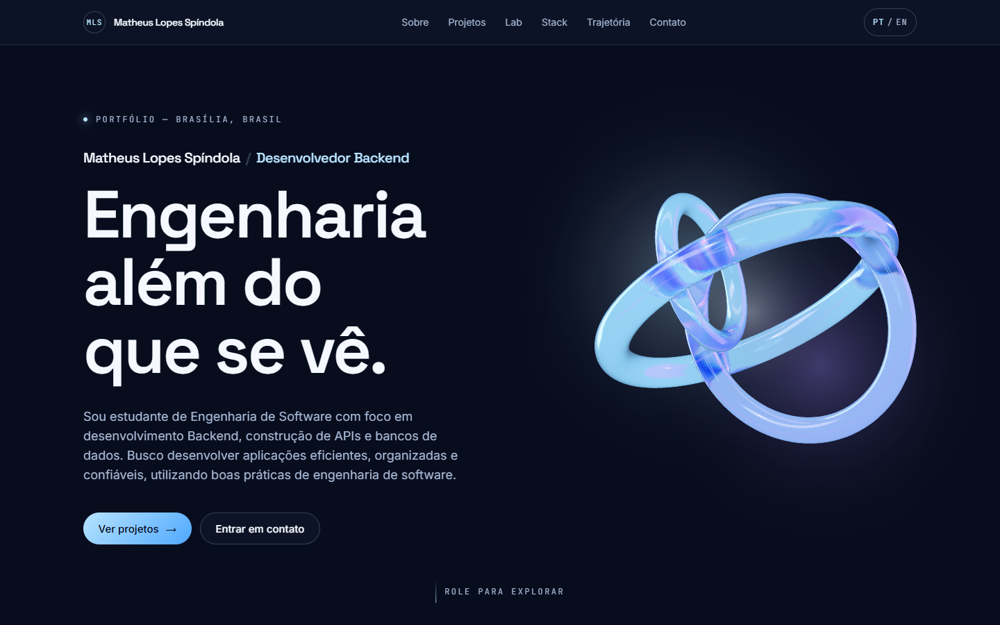

# Matheus Lopes Spíndola — Portfolio

Bilingual (pt-BR / en-US) portfolio for a **Backend Developer (Java)**: a Next.js site with a React Three Fiber hero, backed by a real Spring Boot API that the site itself calls from its **Engineering Lab**.



```
.
├── .claude/agents/   # Claude Code subagents (orquestrador, fabrica-agentes, arquiteto, designer-ux-ui, frontend-3d, backend-java, qa-testes)
├── backend/          # Java 21 · Spring Boot 3.5 · REST API + JUnit tests
├── frontend/         # Next.js 16 · React 19 · TypeScript · Tailwind 4 · three / R3F / drei · GSAP
├── docs/             # contracts, ADRs, design system, QA, deploy, task board
└── CLAUDE.md         # project rules for Claude Code
```

## Requirements
- Java 21+ and Maven 3.9+
- Node.js 20.9+ and npm

## Run locally
```bash
# 1) API — http://localhost:8080  (Swagger UI: /swagger-ui.html)
cd backend
mvn spring-boot:run

# 2) Site — http://localhost:3000  (redirects to /pt or /en)
cd frontend
cp .env.example .env.local     # NEXT_PUBLIC_API_URL=http://localhost:8080
npm install
npm run dev
```
The site still works if the API is down: projects come from a bundled copy (clearly labeled as offline), and the Engineering Lab shows the actual network error. It never shows a fake response.

## API
| Method | Path | Description |
|---|---|---|
| GET | `/api/health` | Service status |
| GET | `/api/projects?lang=pt\|en` | Project catalog |
| GET | `/api/projects/{id}?lang=pt\|en` | Project detail (404 ProblemDetail if unknown) |
| POST | `/api/contact` | Contact form: validation, honeypot, minimum fill time, per-IP rate limit (5 / 10 min), 16 KB body limit |

Full contract: [docs/api/contracts.md](docs/api/contracts.md).

## Tests
```bash
cd backend && mvn -B test                                        # JUnit 5 + MockMvc
cd frontend && npx tsc --noEmit && npm run lint && npm run check:snippets && npm run build  # types, lint, code-showcase drift, build
```
Browser regression scripts (anchor navigation, scroll reveal, API status): [frontend/scripts/qa/](frontend/scripts/qa/). QA strategy and results: [docs/qa/](docs/qa/).

### Current quality status (Lighthouse 12, real runs)
| | Performance | Accessibility | Best Practices | SEO |
|---|---|---|---|---|
| Desktop `/pt` | 99–100 | 100 | 100 | 100 |
| Mobile `/pt` | 73–78 | 100 | 100 | 100 |

Mobile Performance/LCP are below the 85 / 2.5 s goals (QA-01, QA-02 — see [QA_REPORT](docs/qa/QA_REPORT.md)).

## Deploy
Frontend on Vercel (root `frontend`), API as a Docker container (Render / Fly.io / Railway). Step-by-step instructions and environment variables: [docs/deploy.md](docs/deploy.md).
**Before going public**, set `APP_CONTACT_WEBHOOK_URL` and `APP_CONTACT_REQUIRE_DELIVERY=true`; otherwise contact messages are only written to the server log.

## Content placeholders — `TODO(matheus)`
Only verified facts appear on the site ([docs/content/profile.md](docs/content/profile.md)). To complete it, fill in:
- GitHub, LinkedIn, professional e-mail and CV (`frontend/src/content/site.ts`)
- Project repositories, screenshots and confirmed technologies (`backend/src/main/resources/data/projects.json`, then mirror them in `frontend/src/content/projects.ts`)
- Professional experience (Journey section, in `frontend/src/i18n/pt.ts` and `en.ts`)

## Multi-agent workflow (Claude Code)
The `.claude/agents/` folder defines a team of subagents coordinated by `orquestrador`. Start a session with it as the main agent:
```bash
claude --agent orquestrador
```
Responsibilities, file ownership and the policy for adding new agents are in [CLAUDE.md](CLAUDE.md). History: [docs/TASKS.md](docs/TASKS.md) and [docs/AGENTS_REGISTRY.md](docs/AGENTS_REGISTRY.md).

## Architecture decisions
- [ADR-001 — Stack and boundaries](docs/architecture/ADR-001-stack-and-boundaries.md)
- [ADR-002 — Abuse-protection hardening](docs/architecture/ADR-002-abuse-protection-hardening.md)
